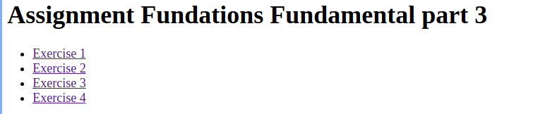

# template-readme

## Built With

- html
- JavaScript 
- VSCode

## Live Demo

[This is Live](https://valerialeonh.github.io/assignment_fundamentals_part3_07sep23/)

## Authors

👤 **Valeria Leon**

- GitHub: [@aValeriaLeonH](https://github.com/ValeriaLeonH)
- Twitter: [colocartwitter]()
- LinkedIn: [LinkedIn](https://www.linkedin.com/in/valeria-leon-30960527a/)

## 🤝 Contributing

Contributions, issues, and feature requests are welcome!

Feel free to check the [issues page](https://github.com/ValeriaLeonH/assignment_fundamentals_part3_07sep23/issues).

## Show your support

Give a ⭐️ if you like this project!

## Acknowledgments

- Hat tip to anyone whose code was used
- Inspiration
- etc

## 📝 License

This project is [CC0 1.0 Universal](LICENSE) licensed.
